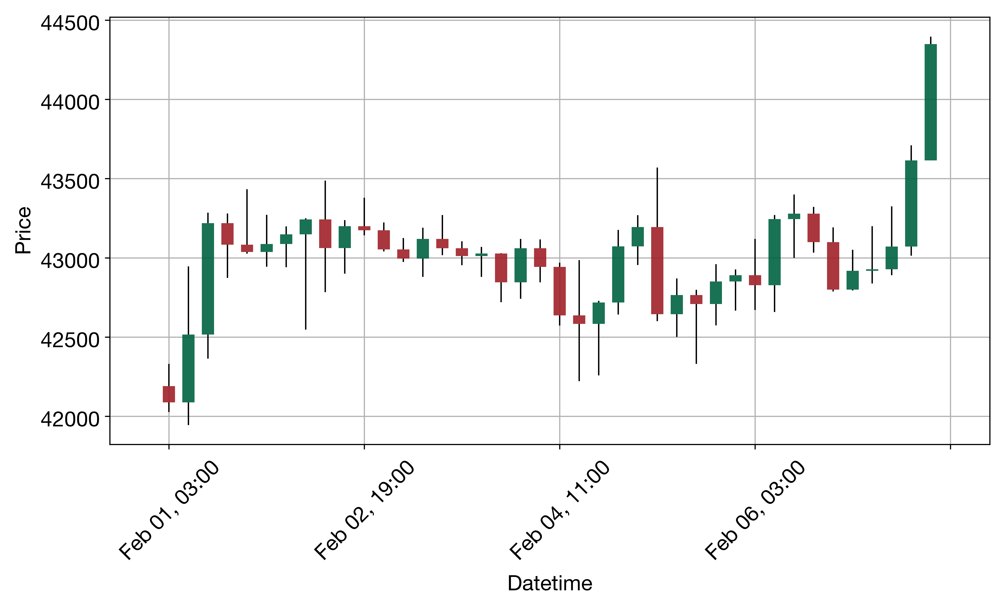
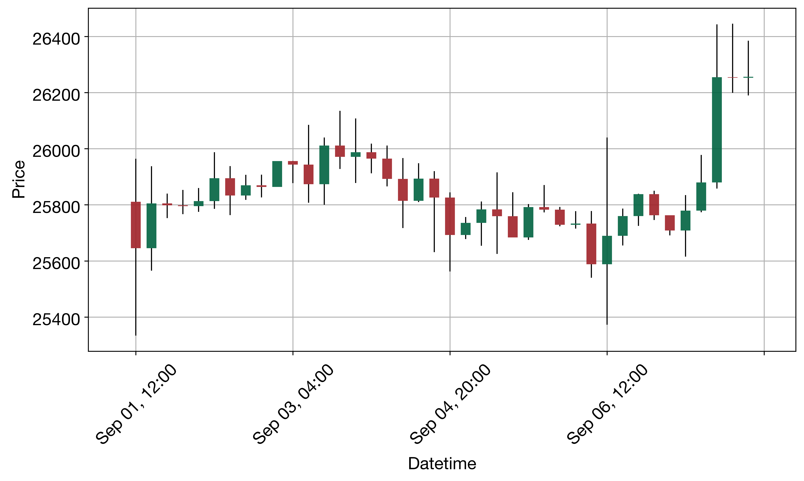

English | [Chinese](README_CN.md)

# QuantAgent BTC 4-Hour Reproduction

This project reproduces QuantAgent's BTC 4-hour directional prediction task using the 100 official samples. DeepSeek replaces the models configured by default in the code, and the experiment runs for three trials. All 300 sample analyses are complete, with a mean directional accuracy of **48.89%** across the three trials.

This repository provides the execution code, official BTC data, per-sample reports, scores, and retry records. Its scope is directional prediction and execution reliability. It does not reproduce all assets, return backtests, or real-time trading in the paper.

## 1. Sources and Reproduction Scope

- Paper: [QuantAgent: Price-Driven Multi-Agent LLMs for High-Frequency Trading, v3](https://arxiv.org/html/2509.09995v3). References are fixed to v3 to avoid mixing paper versions.
- Official repository: [Y-Research-SBU/QuantHarness](https://github.com/Y-Research-SBU/QuantHarness), previously named QuantAgent.
- Official code reference: [`2e64c7befa75a88d254a426f5f29fa61b0b56732`](https://github.com/Y-Research-SBU/QuantHarness/tree/2e64c7befa75a88d254a426f5f29fa61b0b56732). This commit is the public code reference for this reproduction; it does not establish that all model and environment settings from the paper's historical experiments have been verified.
- Data: `benchmark/btc/BTC_4h_1.csv` through `BTC_4h_100.csv`, unchanged from the official commit above.
- Workflow: Indicator Agent → Pattern Agent → Trend Agent → Decision Maker.
- Each file contains 100 candlesticks: the first **97** are supplied to the agents, and the final **3** are reserved for evaluation. The same 100 samples are run in **3 trials**.

The four agent source files, prompts, image tools, and official data remain unchanged. The main experimental modification is the switch to DeepSeek. Integration, batch execution, and scoring additions are documented separately.

## 2. Final Results

| Trial | Completed analyses | Hits / comparisons | Directional accuracy |
|---|---:|---:|---:|
| Trial 1 | 100 / 100 | 144 / 300 | 48.00% |
| Trial 2 | 100 / 100 | 138 / 300 | 46.00% |
| Trial 3 | 100 / 100 | 158 / 300 | 52.67% |
| All three trials | 300 / 300 | 440 / 900 | 48.89% |

- Mean accuracy across trials: **48.8889%**.
- Sample standard deviation: **3.4211 percentage points**, using `ddof=1`.
- Sample variance: **11.7037 squared percentage points**.
- Final sample completed: **10 November 2026 at 00:34:20, Hong Kong time**.

Table 1 in paper v3 reports **50.7%** BTC 4-hour accuracy. This reproduction's mean is approximately **1.81 percentage points** below that published value. The model and environment differ, and there is no local original-model control group under identical conditions. The difference cannot be attributed solely to the model replacement, nor does it establish that DeepSeek is better or worse.

### Scoring Rules

Each sample produces one `LONG` or `SHORT` prediction:

- `LONG`: a future candlestick counts as a hit if its closing price is above the closing price of the 97th historical candlestick.
- `SHORT`: a future candlestick counts as a hit if its closing price is below the closing price of the 97th historical candlestick.
- Equal closing prices do not count as hits.

Each sample receives 0–3 hits, giving 300 directional comparisons per trial. Accuracy is total hits divided by total comparisons. The mean and variance are calculated from the three trial accuracies.

### Retries and Accepted Results

There are **321 saved attempts**: 300 successful attempts and 21 failed or interrupted attempts, affecting 20 sample runs that required another attempt. Eight of the 21 records are interruption signals. The others include empty pattern reports, exhausted request retries, tool workflow errors, and truncated output.

Of the 300 accepted results, 280 come from `attempt_001`, 19 from `attempt_002`, and 1 from `attempt_003`. The accuracy above uses the **final successful attempt** for each sample. Failures are not assigned a default direction, and retry decisions do not depend on whether a prediction was correct. The first-attempt completion rate is 93.33%; because this includes manual interruptions, it cannot be treated directly as model or API reliability.

## 3. Execution Limitations

| Check | Trial 1 | Trial 2 | Trial 3 | Total |
|---|---:|---:|---:|---:|
| Completed results with a pattern chart | 56 | 64 | 60 | 180 / 300 |
| Completed results with a trend chart | 100 | 100 | 100 | 300 / 300 |
| Decisions specifying the next 3 candlesticks | 64 | 62 | 70 | 196 / 300 |
| Decisions specifying the next 1 candlestick | 35 | 38 | 30 | 103 / 300 |
| Decisions specifying the next 1–3 candlesticks | 1 | 0 | 0 | 1 / 300 |

1. **Pattern chart analysis was not completed for every sample.** There are 120 completed results without a pattern chart. The original Pattern Agent permits a text fallback; if that fallback response requests a tool, the original code may also omit its execution. Some nonempty reports contain only statements about intended actions. A completion marker and a nonempty report do not prove that substantive chart analysis took place for every sample.
2. **The stated prediction horizon does not always match the scoring horizon.** There are 103 decisions specifying the next 1 candlestick, while scoring consistently follows the paper's next-3-candlestick rule. Both the `N=1` example and the `next 3` template in the official prompts are preserved. Neither prompts nor scoring were changed during the experiment.
3. **The original code and model replacement limit strict comparisons.** Not all return metrics were reproduced, and directional hit rates cannot be interpreted as trading returns. There is also no strict local control experiment to isolate the causal effect of the model replacement.

These are findings of this reproduction. The primary results retain all 300 final successful results; samples with missing charts, low scores, or inconsistent stated horizons are not selectively removed.

## 4. Inspecting the Saved Results

The complete scoring records are available in:

- [Trial summary](results/formal/baseline/round_summary.csv): completed analyses, hits, and accuracy for each trial.
- [Per-sample scores](results/formal/baseline/scores.csv): the prediction and 0–3 hits for each sample analysis.
- [Full statistics](results/formal/baseline/summary.json): completion status, mean, sample standard deviation, and variance.
- [Experiment configuration and file fingerprints](results/formal/baseline/experiment.json): code, data, model parameters, and package versions.

Each sample directory follows this structure:

```text
results/formal/baseline/
  repeat_01/
    BTC_4h_1/
      completed.json
      attempt_001/
        history.csv
        future.csv
        reports.json
        decision_prompt.txt
        kline_chart.png       # Present only when generated
        trend_graph.png
        record.csv           # Latest 40 bars used for the pattern chart; present only when generated
        metadata.json
        api_diagnostics.jsonl
```

`completed.json` identifies the accepted attempt. If several `attempt_*` directories exist, charts or reports from failed attempts must not be counted as successful results. `error.json` records a failure. `api_diagnostics.jsonl` stores only safe diagnostic information such as status, structure, and hashes; it does not store secrets or the model's reasoning text.

### Two Example Cases

**Correct prediction: trial 1, sample 5.** The prediction is `LONG`, with a reference price of 44,349.60. The next three closing prices are 44,540.99, 44,513.24, and 44,698.97, giving a score of 3/3.



[Analysis report](results/formal/baseline/repeat_01/BTC_4h_5/attempt_001/reports.json) · [Trend chart](results/formal/baseline/repeat_01/BTC_4h_5/attempt_001/trend_graph.png)

**Incorrect prediction: trial 1, sample 1.** The prediction is `LONG`, with a reference price of 26,256.22. The next three closing prices are 25,839.51, 25,844.64, and 25,895.62, giving a score of 0/3.



[Analysis report](results/formal/baseline/repeat_01/BTC_4h_1/attempt_001/reports.json) · [Trend chart](results/formal/baseline/repeat_01/BTC_4h_1/attempt_001/trend_graph.png)

Pattern charts use the latest 40 historical candlesticks from the input. Each candlestick represents 4 hours, and the three future evaluation candlesticks are excluded. Green means the close is above the open; red means the close is below the open. Pattern interpretations are written in the reports.

## 5. Local Setup: Mac and VS Code

In VS Code, choose **File → Open Folder** and open the repository root. Then choose **Terminal → New Terminal**. Run the following commands in that terminal. First use `pwd` and `ls` to confirm that the current directory contains `run_btc.py`.

### 5.1 Create a Separate Python Environment

The experiment used Python **3.11.18**. After installing Anaconda or Miniconda, run the following from the repository root:

```bash
conda create --prefix ./.conda --override-channels -c conda-forge python=3.11.18 pip ta-lib=0.8.3 numpy=2.4.6 -y
.conda/bin/python --version
.conda/bin/python -m pip install -r requirements-repro.txt
.conda/bin/python -m pip check
```

Expected results: Python reports `3.11.18`, and the dependency check reports `No broken requirements found.` If `conda` is unavailable, a common default Anaconda path on Mac is `/opt/anaconda3/bin/conda`; replace `conda` at the start of the first command with the actual path on your machine.

`requirements.txt` preserves the official file. `requirements-repro.txt` records the package versions used for this reproduction. It is a snapshot of the installed environment and has not yet been validated by reinstalling it in a fresh environment with network access. Key versions recorded in the experiment fingerprint include pandas 3.1.1, langchain 1.4.9, langchain-core 1.7.6, langchain-openai 1.7.4, langgraph 1.2.20, openai 3.46.0, and TA-Lib 0.8.3.

In VS Code, press `Command + Shift + P`, select `Python: Select Interpreter`, and choose `.conda/bin/python` inside the repository. Continue using `.conda/bin/python` explicitly in terminal commands to avoid selecting another local Python installation.

### 5.2 Verify Saved Results Without Calling a Model

When the complete results are already present, first run:

```bash
.conda/bin/python verify_results.py
```

The verifier only reads existing files, checks data and report integrity, recomputes scores, and compares the summaries. It does not call a model or make paid model requests. Passing verification does not resolve the analysis quality limitations listed in Section 3.

### 5.3 Configure Your Own API Key

A real API key is needed only when calling the model. Copy the example file:

```bash
cp .env.example .env
```

Open `.env` in VS Code, replace the placeholder with your own key, and save the file:

```dotenv
DEEPSEEK_API_KEY=YOUR_DEEPSEEK_API_KEY
DEEPSEEK_BASE_URL=https://api.deepseek.com
DEEPSEEK_MODEL=deepseek-flash
```

Do not commit `.env` or `.conda/` to GitHub. Do not paste real keys into the README, screenshots, or commit messages.

## 6. Running and Resuming Experiments

The repository already contains the completed records from all three trials. Viewing and verifying them does not require running the models again.

For the first paid run in a **separate working copy with no existing formal output records**, use:

```bash
.conda/bin/python run_btc.py
```

The program runs the official 100 samples × 3 trials and writes to `results/formal/baseline`. `baseline` is only the name of this output group. This group uses DeepSeek; it is not a local GPT control group.

To continue the same experiment after an interruption:

```bash
.conda/bin/python run_btc.py --resume
```

`--resume` verifies and skips completed records. An unfinished sample starts a new `attempt_*` and runs all four agents again. Model requests already processed may have incurred charges, and another attempt makes new requests.

Resuming requires the current code, data, model configuration, Python version, and key package versions to match `experiment.json` exactly. It also requires an API key in `.env`. If all 300 results are complete and the fingerprint matches, the program skips all model calls but still rewrites the summaries. Use `verify_results.py` when you only want to verify the saved results.

This repository does not provide a command to automatically clear formal results. For a new measured run, use a separate working copy and preserve the existing archive. Before preparing an output directory, ensure that completed formal results will not be overwritten, deleted, or mixed with new results. Do not modify the old `experiment.json` to bypass fingerprint checks.

## 7. Model and API Parameters

| Item | Setting used |
|---|---|
| Provider / API | DeepSeek / OpenAI-compatible Chat Completions |
| Model identifier | `deepseek-flash` |
| Base URL | `https://api.deepseek.com` |
| Thinking mode | `enabled` |
| Reasoning effort | `high` |
| Output budget | `max_tokens=16384` |
| Temperature / top_p | Not sent in actual requests; the nominal temperature of 0.1 retained in the configuration must not be treated as the effective temperature |
| Request timeout | 300 seconds |
| SDK retries | 2 |
| Additional invalid-response retry | 1 retry after 2 seconds, keeping the request parameters unchanged |

The original agents also retry tool and model calls, so the system's total retry count is not simply the SDK retry count. Truncated output is rejected explicitly; the system does not automatically increase the budget, switch models, or disable thinking mode.

## 8. Code Changes and Local Tests

- Unchanged: the four agents, official prompts, chart tools, graph structure, and 100 BTC data files.
- `default_config.py`: replaces the code's default GPT models and providers with DeepSeek and records runtime parameters.
- `trading_graph.py`: loads environment configuration and adds the DeepSeek integration branch.
- `deepseek_adapter.py`: preserves `reasoning_content` for tool interactions in thinking mode, validates abnormal responses, and keeps safe diagnostics.
- `run_btc.py`: adds batch execution, per-sample scoring, statistics across three trials, separate attempt directories, and fingerprint checks for resuming.
- `verify_results.py`: independently verifies saved outputs without running a model.
- `tests/test_reproduction.py`: validates data, scoring, protocol handling, abnormal responses, and resume protections offline.

Run the offline tests:

```bash
MPLCONFIGDIR=/tmp/quantagent-mpl PYTHONDONTWRITEBYTECODE=1 .conda/bin/python -B -m unittest discover -s tests -v
```

The tests block real network connections and incur no model charges. The experiment's production source files match the saved fingerprints. Local tests and result verification do not replace manual review of the content of nonempty analysis reports.

## 9. License and Acknowledgments

The original code comes from the Y-Research @SBU team and contributors to the official repository. The original MIT license and copyright notice are retained in [LICENSE](LICENSE). The model integration, experiment execution, and scoring records in this repository are for a course reproduction study. Cite the paper and official repository when referring to the original method.
