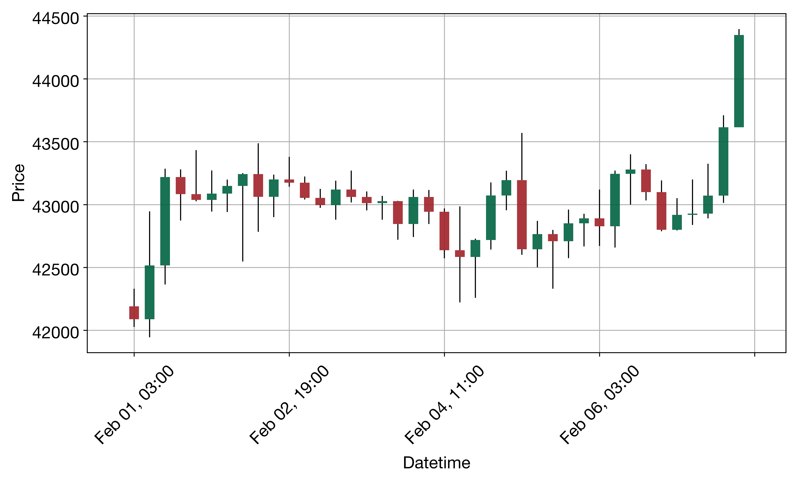
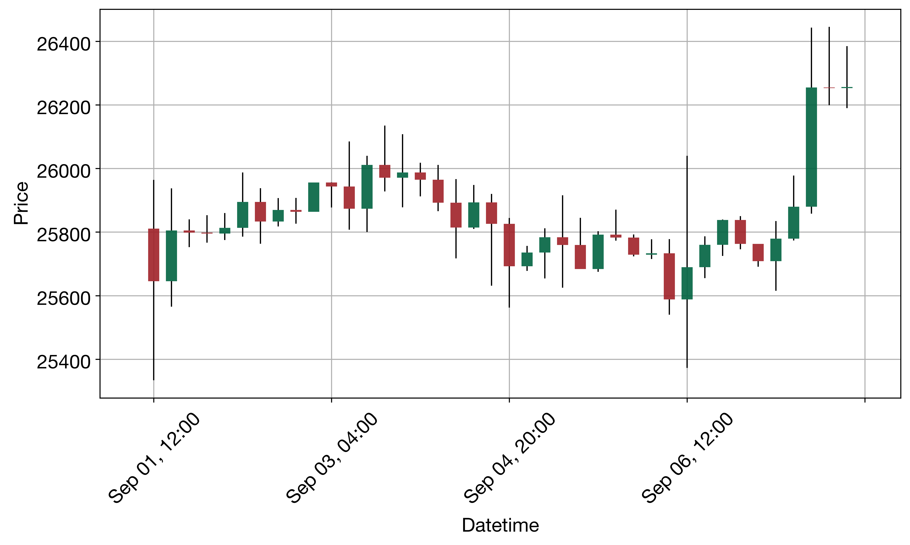

# QuantAgent BTC 4 小时任务复现

[English](README.md) | 简体中文

本项目复现 QuantAgent 的 BTC 4 小时方向预测子任务，使用官方 100 个样本，以 DeepSeek 替换代码默认模型，重复运行三轮。已完成 300 次样本分析，三轮平均准确率为 **48.89%**。

本仓库提供运行代码、官方 BTC 数据、逐样本报告、评分和重试记录。研究范围是方向预测与执行可靠性，没有复现论文的全部资产、收益率回测或实时交易。

## 1. 来源与复现范围

- 论文：[QuantAgent: Price-Driven Multi-Agent LLMs for High-Frequency Trading，v3](https://arxiv.org/html/2509.09995v3)。引用固定为 v3，避免与后续版本混用。
- 官方仓库：[Y-Research-SBU/QuantHarness](https://github.com/Y-Research-SBU/QuantHarness)，原名 QuantAgent。
- 官方代码基准：[`2e64c7befa75a88d254a426f5f29fa61b0b56732`](https://github.com/Y-Research-SBU/QuantHarness/tree/2e64c7befa75a88d254a426f5f29fa61b0b56732)。该提交是本次公开代码比较基准，不代表已核实论文历史实验的全部模型与环境。
- 数据：`benchmark/btc/BTC_4h_1.csv` 至 `BTC_4h_100.csv`，与上述官方提交一致。
- 流程：技术指标代理 → 形态代理 → 趋势代理 → 综合决策代理。
- 每个文件有 100 根 K 线：前 **97 根**提供给代理，后 **3 根**仅用于验证。同一组 100 个样本重复运行 **3 轮**。

四个代理源码、提示词、图像工具和官方数据保留原样。主要实验修改为 DeepSeek 模型替换；接入适配、批量运行和评分辅助的差异另行记录。

## 2. 最终实验结果

| 轮次 | 完成分析 | 命中次数 / 比较次数 | 方向准确率 |
|---|---:|---:|---:|
| 第一轮 | 100 / 100 | 144 / 300 | 48.00% |
| 第二轮 | 100 / 100 | 138 / 300 | 46.00% |
| 第三轮 | 100 / 100 | 158 / 300 | 52.67% |
| 三轮合计 | 300 / 300 | 440 / 900 | 48.89% |

- 三轮准确率均值：**48.8889%**。
- 样本标准差：**3.4211 个百分点**，使用 `ddof=1`。
- 样本方差：**11.7037 平方百分点**。
- 最后一个样本完成时间：**2026 年 11 月 10 日 00:34:20，香港时间**。

论文 v3 表 1 的 BTC 4 小时准确率是 **50.7%**；本次均值比该文献数字低约 **1.81 个百分点**。模型与环境存在差异，本次没有本地同条件的原模型对照组，不能将这项差异单独归因于模型替换，也不据此声称 DeepSeek 更好或更差。

### 评分规则

每个样本只生成一次 `LONG` 或 `SHORT` 方向：

- `LONG`：未来某根收盘价高于第 97 根历史收盘价，记一次命中。
- `SHORT`：未来某根收盘价低于第 97 根历史收盘价，记一次命中。
- 平价不计命中。

每个样本得到 0–3 次命中；每轮共 300 次方向比较。准确率等于命中总数除以比较总数。均值与方差按三轮准确率计算。

### 重试与完成口径

实际共保存 **321 次尝试**：300 次成功尝试和 21 次失败或中断尝试，涉及 20 个需要补跑的样本运行。21 次中有 8 次中断信号，其余包括空形态报告、请求重试耗尽、工具流程异常和输出截断。

300 个被接纳的结果中，280 个来自 `attempt_001`、19 个来自 `attempt_002`、1 个来自 `attempt_003`。上述准确率使用每个样本**最终成功尝试**的结果，失败不填入默认方向，也不按预测对错决定是否重跑。首尝试完成比例为 93.33%；由于包含人为中断，这个比例不能直接解释为模型或 API 的可靠率。

## 3. 必须说明的执行局限

| 检查项 | 第一轮 | 第二轮 | 第三轮 | 合计 |
|---|---:|---:|---:|---:|
| 有形态图的完成结果 | 56 | 64 | 60 | 180 / 300 |
| 有趋势图的完成结果 | 100 | 100 | 100 | 300 / 300 |
| 决策写预测未来 3 根 | 64 | 62 | 70 | 196 / 300 |
| 决策写预测未来 1 根 | 35 | 38 | 30 | 103 / 300 |
| 决策写未来 1–3 根 | 1 | 0 | 0 | 1 / 300 |

1. **形态看图步骤并非全部完成。**120 次完成结果没有形态图。原形态代理允许文字备用路径；若备用回复再次提出工具请求，原代码也可能遗漏执行。部分非空报告只是过程性文字。完成标记与非空报告不能证明每个样本都完成了实质看图分析。
2. **输出预测范围与评分范围存在不一致。**103 份决策写未来 1 根，但统一评分仍按论文的未来 3 根规则。官方提示词中的 `N=1` 示例和 `next 3` 模板均保留，没有在运行途中修改提示词或评分。
3. **原代码和模型替换均限制严格比较。**没有复现所有收益率指标，不能把方向命中率解释为交易收益。也没有进行严格的本地模型因果对照。

这些是本次复现的发现。主结果保留全部 300 个最终成功结果，不选择性删除缺图、低分或预测范围不一致的样本。

## 4. 查看已有结果

完整评分记录位于：

- [每轮汇总](results/formal/baseline/round_summary.csv)：每轮完成数、命中数和准确率。
- [逐样本成绩](results/formal/baseline/scores.csv)：每次样本分析的预测及 0–3 次命中。
- [完整统计](results/formal/baseline/summary.json)：完成状态、均值、样本标准差和方差。
- [实验配置与文件指纹](results/formal/baseline/experiment.json)：代码、数据、模型参数和包版本。

样本目录的结构为：

```text
results/formal/baseline/
  repeat_01/
    BTC_4h_1/
      completed.json
      attempt_001/
        history.csv
        future.csv
        reports.json
        decision_prompt.txt
        kline_chart.png       # 仅在实际生成时存在
        trend_graph.png
        record.csv           # 形态图所用最近40根数据，仅在实际生成时存在
        metadata.json
        api_diagnostics.jsonl
```

`completed.json` 指明本次接纳的尝试。若存在多个 `attempt_*`，不能把失败尝试的图或报告算进成功结果。`error.json` 记录失败；`api_diagnostics.jsonl` 只保存安全的状态、结构与哈希等诊断，不保存密钥或模型思考正文。

### 两个可查看的案例

**预测正确：第一轮第 5 个样本。**预测 `LONG`，参考价 44,349.60；未来三根收盘价为 44,540.99、44,513.24、44,698.97，得分 3/3。



[分析报告](results/formal/baseline/repeat_01/BTC_4h_5/attempt_001/reports.json) · [趋势图](results/formal/baseline/repeat_01/BTC_4h_5/attempt_001/trend_graph.png)

**预测错误：第一轮第 1 个样本。**预测 `LONG`，参考价 26,256.22；未来三根收盘价为 25,839.51、25,844.64、25,895.62，得分 0/3。



[分析报告](results/formal/baseline/repeat_01/BTC_4h_1/attempt_001/reports.json) · [趋势图](results/formal/baseline/repeat_01/BTC_4h_1/attempt_001/trend_graph.png)

形态图使用输入历史中最近 40 根 K 线，每根代表 4 小时，不含留作验证的未来三根。图中绿色为收盘高于开盘、红色为收盘低于开盘；形态名称的解释在报告里。

## 5. 本地安装：Mac 与 VS Code

打开 VS Code，选择“文件 → 打开文件夹”，打开本仓库根目录；再选择“终端 → 新建终端”。下列命令在该终端中执行。先用 `pwd` 和 `ls` 确认当前目录中有 `run_btc.py`。

### 5.1 创建独立 Python 环境

本次实验实际使用 Python **3.11.18**。安装了 Anaconda 或 Miniconda 后，在仓库根目录执行：

```bash
conda create --prefix ./.conda --override-channels -c conda-forge python=3.11.18 pip ta-lib=0.8.3 numpy=2.4.6 -y
.conda/bin/python --version
.conda/bin/python -m pip install -r requirements-repro.txt
.conda/bin/python -m pip check
```

成功信号：Python 显示 `3.11.18`，依赖检查显示 `No broken requirements found.`。若 `conda` 命令不可用，Mac 的 Anaconda 默认路径常见为 `/opt/anaconda3/bin/conda`，可将第一条命令开头的 `conda` 换为该实际路径。

`requirements.txt` 保留官方文件；`requirements-repro.txt` 用于记录本次复现的实际依赖版本，是已安装环境的版本快照，尚未在全新联网环境重新安装验证。实验指纹中的关键版本包括 pandas 3.1.1、langchain 1.4.9、langchain-core 1.7.6、langchain-openai 1.7.4、langgraph 1.2.20、openai 3.46.0 和 TA-Lib 0.8.3。

在 VS Code 中按 `Command + Shift + P`，选择 `Python: Select Interpreter`，再选择仓库内 `.conda/bin/python`。命令行继续明确使用 `.conda/bin/python`，避免误用其他本地 Python。

### 5.2 核验已有结果：不调用模型

已有完整结果时，先执行：

```bash
.conda/bin/python verify_results.py
```

该核验程序只读取已有文件，检查数据和报告完整性、重新评分并比对汇总，不调用模型、不需要付费模型请求。核验通过不等于消除了第 3 节列明的分析质量局限。

### 5.3 配置自己的密钥

只有需要调用模型时才需要真实密钥。复制示例：

```bash
cp .env.example .env
```

在 VS Code 打开 `.env`，将占位符替换为自己的密钥并保存：

```dotenv
DEEPSEEK_API_KEY=填写自己的密钥
DEEPSEEK_BASE_URL=https://api.deepseek.com
DEEPSEEK_MODEL=deepseek-flash
```

`.env` 与 `.conda/` 不提交到 GitHub。也不要把真实密钥粘贴到 README、截图或提交消息中。

## 6. 运行与中断续跑

仓库已经包含三轮完成记录，查看和核验它们不需要重新运行模型。

在**尚无正式输出记录的独立工作副本**中，首次付费运行使用：

```bash
.conda/bin/python run_btc.py
```

程序固定运行官方 100 个样本 × 3 轮，写入 `results/formal/baseline`。`baseline` 只是本次结果目录名称，这组实际使用 DeepSeek，并不是本地 GPT 对照组。

中断后继续同一实验：

```bash
.conda/bin/python run_btc.py --resume
```

`--resume` 会核验已经完成的记录并跳过它们；未完成样本从新的 `attempt_*` 开始，重新运行四代理。已经消耗的模型请求可能产生费用，补跑也会产生新请求。

续跑要求当前代码、数据、模型配置、Python 和关键依赖版本与 `experiment.json` 完全一致，并要求 `.env` 中有密钥。已有 300 个完整结果且指纹一致时，程序会跳过全部模型调用，但仍会重写汇总文件；仅核验现有成果应优先使用 `verify_results.py`。

本仓库不提供自动清空正式结果的命令。需要全新实测时，使用独立工作副本并保留现有归档；准备输出目录前先确认不会覆盖、删除或混入已完成的正式结果。不要修改旧 `experiment.json` 来绕过指纹检查。

## 7. 模型与接入参数

| 项目 | 本次设置 |
|---|---|
| 提供商 / API | DeepSeek / OpenAI-compatible Chat Completions |
| 模型标识 | `deepseek-flash` |
| Base URL | `https://api.deepseek.com` |
| 思考模式 | `enabled` |
| 推理强度 | `high` |
| 输出预算 | `max_tokens=16384` |
| 温度 / top_p | 实际请求不发送；不能把配置文件保留的温度 0.1 当成实际有效温度 |
| 请求超时 | 300 秒 |
| SDK 重试 | 2 次 |
| 异常响应额外重试 | 1 次，等待 2 秒，保持原请求参数 |

原代理自身还有工具与模型重试，因此整个系统的总重试次数不能简单等同于 SDK 重试次数。输出截断会明确失败，不自动增加预算、切换模型或关闭思考模式。

## 8. 代码差异与本地测试

- 保持原样：四个代理、官方提示词、图工具、图结构及 100 个 BTC 数据文件。
- `default_config.py`：将代码默认的 GPT 模型和提供商切换为 DeepSeek，记录运行参数。
- `trading_graph.py`：加载环境配置并增加 DeepSeek 接入分支。
- `deepseek_adapter.py`：保留思考模式工具交互所需的 `reasoning_content`，验证异常响应，保留安全诊断。
- `run_btc.py`：增加批量运行、逐样本评分、三轮统计、独立尝试目录和续跑指纹校验。
- `verify_results.py`：独立核验已有输出，不运行模型。
- `tests/test_reproduction.py`：离线验证数据、计分、协议、异常响应及续跑保护。

运行离线测试：

```bash
MPLCONFIGDIR=/tmp/quantagent-mpl PYTHONDONTWRITEBYTECODE=1 .conda/bin/python -B -m unittest discover -s tests -v
```

测试拦截真实网络连接，不产生模型费用。实验生产源码与保存的指纹一致；本地测试与结果核验不能替代对非空分析报告内容的人工审阅。

## 9. 许可证与致谢

原始代码来自 Y-Research @SBU 团队及官方仓库贡献者，原始 MIT 许可证和版权声明保留于 [LICENSE](LICENSE)。本仓库的模型接入、实验运行和评分记录用于课程复现研究；引用原方法时应引用论文和官方仓库。
