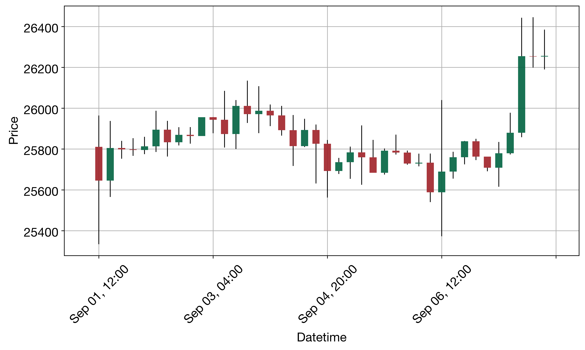
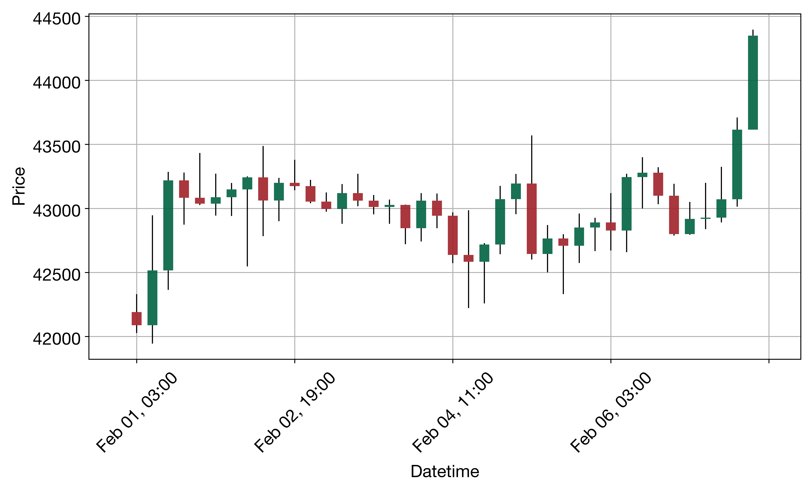

# BTC 4 小时复现结果

本页记录在官方 BTC 4 小时数据上使用 DeepSeek 运行 QuantAgent 的实测结果。结果来自 `results/formal/baseline`，不是论文成绩的复制，也不表示所有样本都完成了形态看图分析。

## 实验范围和评分

- 论文版本：[QuantAgent，arXiv:2509.09995v3](https://arxiv.org/html/2509.09995v3)。
- 官方代码基准：`2e64c7befa75a88d254a426f5f29fa61b0b56732`。
- 数据：官方 100 个 `BTC_4h_*.csv`，每个文件有 100 根 K 线；前 97 根交给系统，后 3 根仅用于验证。三轮使用相同的 100 段数据。
- 模型：`deepseek-flash`，`thinking=enabled`，`reasoning_effort=high`，`max_tokens=16384`。详细有效配置和包版本见 [experiment.json](results/formal/baseline/experiment.json)。
- 预测只有 `LONG` 或 `SHORT`。以最后一根历史收盘价为基准，分别比较未来三根收盘价：LONG 对应高于基准，SHORT 对应低于基准；平价不命中。每个样本命中数为 0–3，每轮分母为 300。
- 未复现收益率、止损止盈收益、其他资产或其他时间周期。本次主指标仅为方向准确率。

## 三轮主结果

| 轮次 | 完成样本 | 命中 / 方向比较数 | 准确率 |
|---|---:|---:|---:|
| 第一轮 | 100/100 | 144/300 | 48.00% |
| 第二轮 | 100/100 | 138/300 | 46.00% |
| 第三轮 | 100/100 | 158/300 | 52.67% |
| 合计 | 300/300 | 440/900 | 48.89% |

- 三轮平均准确率：**48.8889%**。
- 样本标准差：**3.4211 个百分点**。
- 样本方差：**11.7037 平方百分点**。
- 标准差和方差以三轮准确率为观测值，采用 `ddof=1`，不是对 900 次相关方向比较作独立性假设。
- 最后一个结果完成时间：**2026-11-10 00:34:20，香港时间**。

原始汇总：[summary.json](results/formal/baseline/summary.json)、[round_summary.csv](results/formal/baseline/round_summary.csv)、[scores.csv](results/formal/baseline/scores.csv)。

## 与论文的参考比较

论文 v3 的表 1 报告 BTC 4 小时方向准确率为 **50.7%**。本次三轮均值为 **48.89%**，描述性差异约为 **−1.81 个百分点**。

本次使用了不同的底层模型，作者历史实验的全部模型快照和环境也未完全核实。因此，论文成绩是文献参考值，不能把上述差异解释为“更换 DeepSeek 单独导致准确率下降”，也不能认为已严格复现论文的全部效果。原仓库默认模型配置不等于已经确认论文运行时使用的模型配置。

## 执行质量与预测范围

以下统计只计算各 `completed.json` 指向的成功 attempt，不把失败尝试中的图片重复计算。

| 轮次 | 形态图 | 趋势图 | 决策写未来 3 根 | 写未来 1 根 | 写未来 1–3 根 |
|---|---:|---:|---:|---:|---:|
| 第一轮 | 56/100 | 100/100 | 64 | 35 | 1 |
| 第二轮 | 64/100 | 100/100 | 62 | 38 | 0 |
| 第三轮 | 60/100 | 100/100 | 70 | 30 | 0 |
| 合计 | **180/300** | **300/300** | **196** | **103** | **1** |

必须保留的限制：

1. **120/300 次成功分析没有形态图文件。**原作者代码允许没有图片时返回文字备用结果；部分抽查报告只是准备画图或泛化文字。非空报告及完成标记不能证明完成了实质的形态看图分析。形态图存在本身也不保证分析正确。
2. **103 份最终决策声明预测未来 1 根，而主评分统一按未来 3 根执行。**原决策提示词混用了 `N=1` 示例和 `next 3` 输出模板。本次为保留官方提示词没有中途修正它；这一范围不一致限制了主成绩与论文三根任务的直接可比性。
3. 缺图与预测范围问题没有被当作理由删除样本或重跑已经成功保存的预测。主表包含全部 300 个最终成功结果，不能只选择有图或预测正确的样本得到更好看的主成绩。
4. 没有运行相同条件下的本地原模型对照组；也没有进行缺图修复后的因果对照。因此无法单独量化模型替换或缺图流程对准确率的影响。

## 失败、中断和续跑口径

正式实验共有 **321 个 attempt**：300 个最终成功结果、21 次失败或中断记录，涉及 20 个样本运行。

| 原因 | 记录数 |
|---|---:|
| 收到中断信号 `KeyboardInterrupt` | 8 |
| 空 `pattern_report` | 9 |
| 请求重试耗尽 | 2 |
| `StopIteration` | 1 |
| 输出达到长度上限 | 1 |
| 合计 | **21** |

300 个最终成功结果中，280 个保存在 `attempt_001`，19 个保存在 `attempt_002`，1 个保存在 `attempt_003`。续跑只重新尝试未完成的样本，不根据预测对错决定是否重跑；失败日志保留，不覆盖之前的 attempt。

主表准确率是每个样本**最终成功 attempt**的得分。280/300 是首次尝试完成比例，不能视作纯模型或 API 的成功率，因为其中包含 8 次中断，也存在原程序流程错误。此前所有失败记录对应的样本都已补跑成功，最终没有缺失样本。

## 可检查的两个案例

两个案例均有形态图、趋势图和明确的未来三根预测说明。图片只展示推理时可见的历史窗口，未来三根未包含在输入图片中。

### 预测错误：第一轮，样本 1

- 系统预测：`LONG`。
- 最后历史收盘价：26,256.22。
- 未来三根收盘价：25,839.51、25,844.64、25,895.62，全部低于基准价。
- 得分：**0/3**。有完整图像分析材料仍可能预测错误。
- [四份报告](results/formal/baseline/repeat_01/BTC_4h_1/attempt_001/reports.json)、[完成与评分记录](results/formal/baseline/repeat_01/BTC_4h_1/completed.json)。

### 预测正确：第一轮，样本 5

- 系统预测：`LONG`。
- 最后历史收盘价：44,349.60。
- 未来三根收盘价：44,540.99、44,513.24、44,698.97，全部高于基准价。
- 得分：**3/3**。
- [四份报告](results/formal/baseline/repeat_01/BTC_4h_5/attempt_001/reports.json)、[完成与评分记录](results/formal/baseline/repeat_01/BTC_4h_5/completed.json)。

## 核验范围

已从保存的历史价格、未来价格和最终预测独立复算全部 300 个得分，结果与完成标记及三份汇总一致。各成功 attempt 的历史数据、未来数据和报告可按 `completed.json` 中记录的 SHA-256 检查。实验所用源代码和数据指纹保存在 `experiment.json`，不能通过修改旧指纹把不同配置混为同一实验。

这些检查确认保存与计分的一致性，不证明每一份模型报告中的技术指标文字、形态判断或交易解释都正确，也不消除上述流程局限。模型费用未根据不完整的本地日志推算为实际账单。
